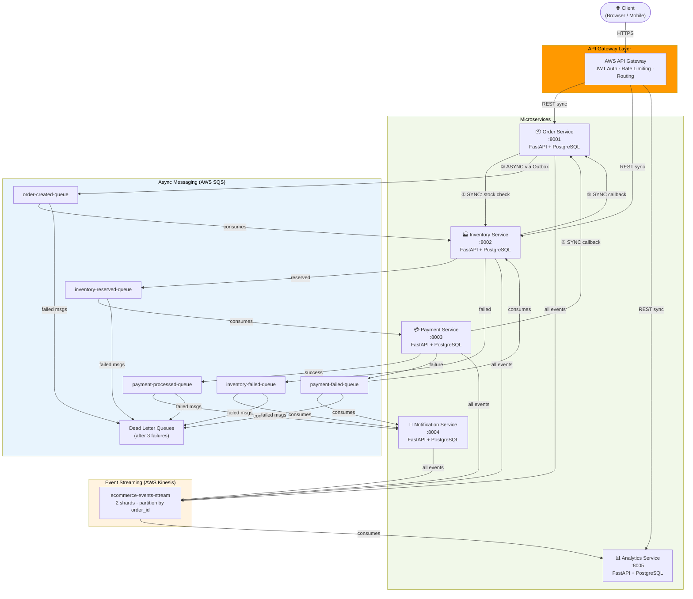

# OrderStream — Python Microservices Platform

> A production-grade e-commerce microservices platform built with Python, PostgreSQL, AWS SQS, and AWS Kinesis.
> Designed to **teach microservice architecture** through a real-world order processing domain.

---

## Architecture Overview



---

## Communication Patterns

| Interaction | Pattern | Transport | Why |
|---|---|---|---|
| Client → Order Service | **Sync REST** | HTTP (API Gateway) | Client needs immediate `order_id` |
| Order Service → Inventory (stock check) | **Sync REST** | HTTP | Must know availability before accepting |
| Order Service → Inventory (reserve stock) | **Async Event** | SQS | No need to block; retryable on failure |
| Inventory → Payment | **Async Event** | SQS | Decoupled; payment processing takes time |
| Payment → Notification | **Async Event** | SQS | Fire-and-forget; non-critical path |
| Payment → Order (status update) | **Sync REST callback** | HTTP | Order needs authoritative final status |
| All Services → Analytics | **Async Stream** | Kinesis | High-throughput, ordered per order_id |

---

## Data Flow: Happy Path (Place Order)

```
Step  Service             Action
----  ------------------  -----------------------------------------------------------
 1.   Client              POST /orders  →  API Gateway
 2.   API Gateway         Validates JWT, routes to Order Service
 3.   Order Service       SYNC → GET /inventory/check (verify stock available)
 4.   Inventory Service   Returns stock OK
 5.   Order Service       Writes order (PENDING) + outbox event atomically in one DB TX
 6.   Order Service       Returns 202 Accepted { order_id, status: "PENDING" }
 7.   OutboxPublisher     Background task polls outbox → publishes to SQS order-created-queue
 8.   Inventory Service   Polls SQS → receives OrderCreated → reserves stock (idempotent)
 9.   Inventory Service   Publishes to SQS inventory-reserved-queue
10.   Inventory Service   Publishes StockReserved → Kinesis
11.   Payment Service     Polls SQS → receives InventoryReserved → calls mock gateway
12.   Payment Service     Publishes to SQS payment-processed-queue
13.   Payment Service     SYNC → PATCH /orders/{id}/status = CONFIRMED
14.   Payment Service     Publishes PaymentSucceeded → Kinesis
15.   Notification Svc    Polls SQS → sends order confirmation email
16.   Analytics Service   Polls Kinesis → ingests all events → updates metrics tables
17.   Client              GET /orders/{id}  →  sees status: CONFIRMED ✅
```

## Data Flow: Payment Failure

```
Step  Service             Action
----  ------------------  -----------------------------------------------------------
1-10. (same as happy path through stock reservation)
11.   Payment Service     Calls gateway → DECLINED
12.   Payment Service     Publishes to payment-failed-queue
13.   Payment Service     SYNC → PATCH /orders/{id}/status = PAYMENT_FAILED
14.   Inventory Service   Consumes payment-failed-queue → releases stock reservation
15.   Notification Svc    Consumes payment-failed-queue → sends "payment failed" email
```

## Data Flow: Out of Stock

```
Step  Service             Action
----  ------------------  -----------------------------------------------------------
 1-7. (order created → outbox → SQS)
 8.   Inventory Service   Receives OrderCreated → insufficient stock
 9.   Inventory Service   Publishes to inventory-failed-queue
10.   Notification Svc    Sends "out of stock" email to customer
11.   Order Service       PATCH /orders/{id}/status = CANCELLED
```

---

## Key Architectural Patterns

| Pattern | Where | What It Teaches |
|---|---|---|
| **Outbox Pattern** | Order Service | Atomic event publishing without distributed TX |
| **Saga (Choreography)** | All services via SQS | Event-driven coordination without a central orchestrator |
| **Database-per-Service** | Each service has its own PostgreSQL | Service isolation, no shared schema |
| **Idempotency** | Inventory & Payment | Safe message reprocessing (at-least-once delivery) |
| **Dead Letter Queue** | All SQS queues | Failure isolation, no lost messages |
| **Kinesis Partitioning** | Analytics stream | Ordering guarantee per `order_id` on same shard |
| **Circuit Breaker** | API Gateway → services | Fast failure, prevent cascade |
| **Long Polling** | SQS consumers | Reduces cost by 95% vs short polling |

---

## Services

| Service | Port | Responsibilities |
|---|---|---|
| **Order Service** | 8001 | Create/manage orders, outbox publisher, status hub |
| **Inventory Service** | 8002 | Product catalog, stock reservations, SQS consumer |
| **Payment Service** | 8003 | Payment processing, idempotency, retry |
| **Notification Service** | 8004 | Email/SMS delivery via SES/SNS stubs |
| **Analytics Service** | 8005 | Kinesis consumer, real-time metrics API |

---

## Tech Stack

| Layer | Technology |
|---|---|
| Language | Python 3.12 |
| Framework | FastAPI (async) |
| Database | PostgreSQL 16 (one per service) |
| ORM | SQLAlchemy 2.0 (async) + Alembic |
| Message Queue | AWS SQS (LocalStack locally) |
| Event Stream | AWS Kinesis (LocalStack locally) |
| API Gateway | AWS API Gateway (Nginx locally) |
| Containers | Docker + Docker Compose |
| AWS SDK | aioboto3 (async) |

---

## SQS Queues

| Queue | Producer | Consumer | DLQ? |
|---|---|---|---|
| `order-created-queue` | Order Service | Inventory Service | Yes (3 retries) |
| `inventory-reserved-queue` | Inventory Service | Payment Service | Yes |
| `inventory-failed-queue` | Inventory Service | Notification Service | Yes |
| `payment-processed-queue` | Payment Service | Notification Service | Yes |
| `payment-failed-queue` | Payment Service | Inventory + Notification | Yes |

---

## Kinesis Stream

| Stream | Producers | Consumer | Shards | Partition Key |
|---|---|---|---|---|
| `ecommerce-events-stream` | All services | Analytics Service | 2 | `order_id` (ordered per order) |

---

## Project Structure

```
orderstream/
├── README.md
├── docker-compose.yml
├── Makefile
├── .env.example
│
├── infrastructure/
│   ├── localstack/
│   │   └── init-aws.sh          # Creates SQS queues + Kinesis streams
│   ├── postgres/
│   │   └── init-multiple-dbs.sh # One DB per service
│   ├── nginx/
│   │   └── nginx.conf           # Local API Gateway proxy
│   └── seeds/
│       ├── products.json        # Seed product data
│       └── test_order.json      # Sample order payload
│
├── shared/                      # Shared across all services
│   ├── messaging/
│   │   ├── schemas.py           # Pydantic SQS/Kinesis event contracts
│   │   ├── sqs_client.py        # Publish + consume wrappers
│   │   └── kinesis_client.py    # put_record wrapper
│   ├── auth/
│   │   └── jwt_validator.py     # JWT decode/verify
│   └── database/
│       └── base.py              # SQLAlchemy declarative base
│
├── services/
│   ├── order_service/           # The entry point service
│   ├── inventory_service/       # Stock management + SQS consumer
│   ├── payment_service/         # Payment + idempotency
│   ├── notification_service/    # Email/SMS delivery
│   └── analytics_service/       # Kinesis consumer + metrics API
│
└── tests/
    ├── integration/             # End-to-end flow tests
    └── unit/                    # Per-service unit tests
```

---

## Quick Start

```bash
# 1. Clone and configure
git clone https://github.com/Tevaalgorithms/orderstream.git
cd orderstream
cp .env.example .env

# 2. Start everything (LocalStack + all DBs + all services)
make up

# 3. Run migrations
make migrate

# 4. Seed product catalog
make seed

# 5. Place a test order and watch the saga unfold
make place-order

# 6. View analytics
curl http://localhost:8000/analytics/orders/summary
```

---

## Learning Goals

After working through this project you will understand:

- [x] How to decompose a monolith into bounded context services
- [x] When to use synchronous REST vs asynchronous messaging
- [x] The Outbox Pattern — guaranteed event delivery without distributed transactions
- [x] The Saga Pattern (choreography) — coordinating multi-step workflows without a central controller
- [x] Idempotency — safe processing of duplicate messages (at-least-once delivery)
- [x] Dead Letter Queues — what happens when messages fail repeatedly
- [x] Kinesis sharding and partition key strategy
- [x] Database-per-Service — why services cannot share a database
- [x] How to develop AWS-dependent services locally using LocalStack

---

## Production Considerations

> These are documented for learning — not all are implemented in the local dev version.

1. **Service Discovery** — Use AWS Cloud Map or internal ALB (Docker Compose DNS locally)
2. **Observability** — Structured JSON logs (structlog) + AWS X-Ray for distributed tracing
3. **Schema Registry** — AWS Glue Schema Registry to prevent breaking Kinesis event changes
4. **Kinesis Enhanced Fan-Out** — HTTP/2 push consumer replaces polling in production
5. **SQS FIFO** — Switch to FIFO queues for exactly-once semantics if needed
6. **Secrets Management** — AWS Secrets Manager replaces `.env` files
7. **ECS/EKS Deployment** — Each service becomes an ECS task or Kubernetes deployment
8. **API Gateway Authorizer** — JWT validated at gateway; services trust the internal network

---

*Built by [Tevaganthan Veluppillai](https://github.com/Tevaalgorithms) · [Medium](https://medium.com/@teva15) · [LinkedIn](https://www.linkedin.com/in/tevaganthan)*
